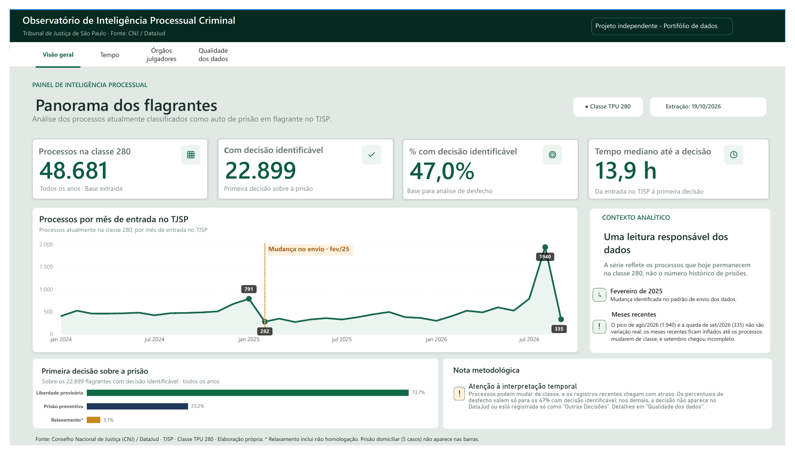
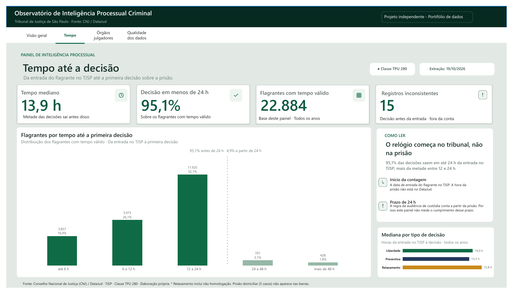
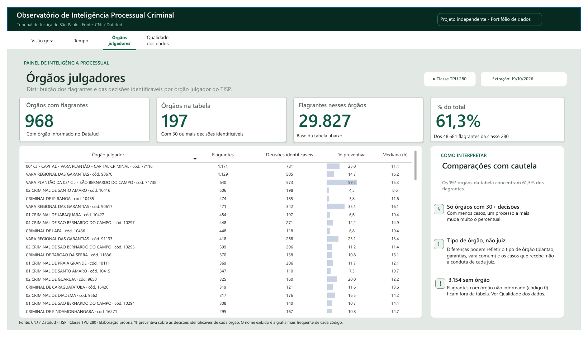
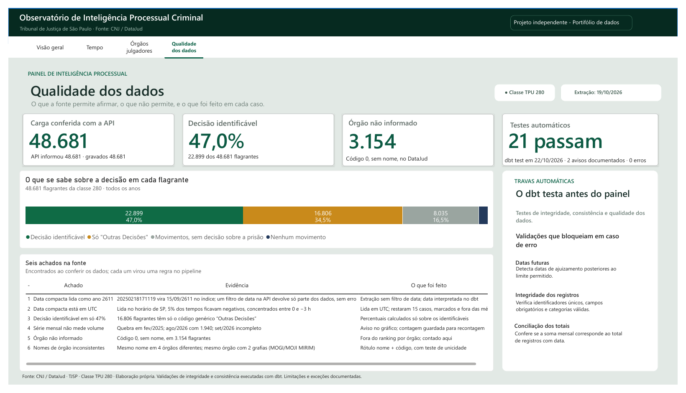

# Observatório de Inteligência Processual Criminal — TJSP


Projeto de portfólio de Engenharia de Dados: **API DataJud (CNJ) → Python/httpx → PostgreSQL → dbt → Power BI**,
aplicado aos autos de prisão em flagrante (classe TPU 280) do TJSP.

## Em resumo
- **Extração completa e conferida:** 48.681 documentos da classe 280; a API informou 48.681 e o banco gravou 48.681.
- **A fonte tem defeitos, e eles foram tratados:** parte das datas é indexada como o ano 2611 (um filtro de data na API devolve só uma fração dos dados, sem erro); a data compacta está em UTC; o órgão julgador vem sem código ou com nomes repetidos. Cada achado virou uma regra no pipeline e um teste.
- **O que os dados permitem afirmar:** a decisão sobre a prisão é identificável em 47% dos flagrantes. Nesses, a primeira decisão foi liberdade provisória em 73,7%, preventiva em 23,2% e relaxamento ou não homologação em 3,1%; a mediana é de 13,9 h da entrada no TJSP à decisão, e 95,1% saem em menos de 24 h.
- **O que não permitem:** a série mensal mostra os processos que estão hoje na classe 280, não o volume de prisões no tempo; e o tempo conta da entrada no tribunal, não da prisão.
- **Testes:** 16 testes unitários e 23 testes de dados no dbt (os bloqueantes impedem a atualização do painel). Rodam a cada push no GitHub Actions com dados sintéticos; o resultado na carga real está em [`docs/evidencia_testes.md`](docs/evidencia_testes.md).

## Painel
| | |
|---|---|
|  |  |
|  |  |

Quatro páginas no Power BI: visão geral, tempo até a decisão, órgãos julgadores e qualidade dos dados. As imagens mostram só números agregados. O `.pbix` não é versionado, porque guarda os dados importados; [`powerbi/POWER_BI_GUIA.md`](powerbi/POWER_BI_GUIA.md) descreve como remontá-lo.

## Arquitetura
```
API pública DataJud (CNJ)
   │  ingestion/  httpx · filtro só por classe · paginação search_after segura contra empates
   │              retries (504, 429, shard parcial) · checkpoint retomável · conferência com o total da API
   ▼
PostgreSQL  raw.datajud_document (JSON bruto, upsert por _id) · raw.ingestion_run · raw.ingestion_checkpoint
   │
   ▼  dbt/
staging   stg_processos ........ datas nos dois formatos (UTC), cópias vigentes
marts     fct_processos · fct_movimentos · fct_desfecho_flagrante (primeira decisão sobre a prisão)
reports   rpt_desfecho_mensal · rpt_tempo_faixas · rpt_desfecho_orgao (rótulo único por código)
quality   qa_cobertura · qa_desfecho ......... o que entra, o que fica de fora e por quê
tests     bloqueiam: datas futuras, soma mensal, partição do desfecho, chaves, rótulo de órgão
          avisam:    datas antes de 1990, decisão antes da entrada
   │
   ▼
Power BI  4 páginas, só leitura das tabelas prontas (nenhum cálculo de negócio no painel)
```

## Entregas
- Cliente assíncrono `httpx`, retries e timeout
- Extração ELT por classe TPU, retomável por checkpoint, com paginação `search_after` e conferência contra a API
- Upsert idempotente dos documentos por `_id` do DataJud
- Tabelas JSONB de origem no PostgreSQL
- Transformações, agregados e testes de qualidade via dbt
- Gerador de dados **inteiramente sintéticos** que reproduz os casos da carga real
- Testes unitários (pytest) e integração contínua (GitHub Actions)
- Guia de conexão, medidas e páginas no Power BI

## Rodar sem a API (dados sintéticos)
Reproduz todo o pipeline em poucos minutos, sem chave da API e sem dados reais:
```bash
python3 -m venv .venv && source .venv/bin/activate
pip install -r requirements.txt
python -m pytest -q                                  # 16 testes unitários
docker compose up -d                                 # PostgreSQL na porta 5433
python -m ingestion.demo_seed                        # 300 flagrantes fictícios (+30 de outras classes)
cp dbt/profiles.yml.example dbt/profiles.yml
dbt seed --project-dir dbt --profiles-dir dbt
dbt run  --project-dir dbt --profiles-dir dbt
dbt test --project-dir dbt --profiles-dir dbt        # PASS=23 nos sintéticos
```
Os flagrantes sintéticos têm `_id` começando com `DEMO_` e órgãos "fictícios", e cobrem as situações que a carga real revelou: datas nos dois formatos, as 4 situações do desfecho, órgão não informado e dois órgãos com o mesmo nome. Para ver o painel, conecte o Power BI a esse banco seguindo o guia; os números serão os sintéticos.

**Não misture:** dados sintéticos e carga real no mesmo banco entram juntos nas contagens. Use um banco limpo para cada um.

## Ingestão real (ELT)
Requer a chave pública da API em `.env` (`cp .env.example .env` e preencha `DATAJUD_API_KEY` conforme a [documentação do CNJ](https://datajud-wiki.cnj.jus.br/api-publica/acesso/)).

A extração filtra na fonte **apenas pela classe** (TPU/CNJ) e traz todos os anos. O recorte de período é feito no dbt.

| Código | Classe | Documentos no índice (out/2026) |
|---|---|---|
| 280 | Auto de Prisão em Flagrante | 48.681 |
| 283 | Ação Penal - Procedimento Ordinário | não medido de forma confiável (não extraída) |

```bash
python -m ingestion.run --class-codes 280
```
- **Retomável:** depois de cada lote, o cursor é salvo em `raw.ingestion_checkpoint`. Se a API cair, rode **o mesmo comando**: a carga continua de onde parou. `--restart` recomeça do zero.
- **API instável:** para deixar rodando sozinho até o fim (macOS):
  ```bash
  caffeinate -i zsh -c 'until python -m ingestion.run --class-codes 280; do sleep 300; done'
  ```
- Em seguida, `dbt run` e `dbt test`.

### Conferência
No fim, a carga compara o **total da classe informado pela API** (`size: 0`, `track_total_hits`) com os **documentos gravados por esta carga**. A conferência não usa nenhum critério além da classe, para não herdar um eventual erro da extração. Só com os números iguais o checkpoint vira `done`. Se divergir (`mismatch`), rodar de novo retoma do fim e confere outra vez. Divergências pequenas e persistentes costumam vir de processos que mudaram de classe durante a carga.

Se a divergência persistir em execuções seguidas, use `--restart`: em geral são processos que saíram da classe durante a carga.

### Cópias velhas e fuso horário
- **Cópias velhas:** um processo que sai da classe (ou do índice) não volta mais na extração, mas a cópia antiga continua no banco. O `stg_processos` marca como `vigente` só o que foi visto na **última carga completa e conferida** da classe; o `fct_processos` usa só os vigentes, e a `qa_cobertura` conta os demais em `fora_da_ultima_carga`.
- **Fuso:** o mês de ajuizamento é calculado no horário de São Paulo, qualquer que seja o fuso do servidor (o Postgres do Docker roda em UTC).

Cada execução fica em `raw.ingestion_run` (`success`, `partial`, `failed` ou `mismatch`, com a mensagem na coluna `error`).

## Achado: as datas do DataJud
A carga real revelou um defeito na fonte oficial. `dataAjuizamento` chega em **dois formatos**, que convivem nos mesmos meses: ISO (`2024-12-10T10:00:00.000Z`) e compacto (`20250218171119`). O índice do DataJud **não entende o formato compacto** e lê o número como milissegundos desde 1970:

| Texto enviado pelo TJSP | Data gravada no índice |
|---|---|
| `20250218171119` (18/02/2025 17:11) | `2611-09-15T12:36:11.119Z` |

Consequências observadas antes da correção:
- um filtro de período por mês **retornava 0 documentos** de fev a dez/2025, sem erro nenhum;
- um limite com 14 dígitos virava o ano 2611, e a janela de dezembro trazia 38.441 documentos em vez de 355;
- a conferência por mês "batia", porque contava com o mesmo filtro defeituoso que extraía. **Uma conferência que usa o critério da extração não detecta erro no critério.**

Números contaminados pelo defeito (não usar): uma contagem "desde 2024-01-01" com `range` simples dava 33.603 para a classe 280, porque todo documento em formato compacto, de qualquer ano, "está" em 26xx e passa no filtro. O total real de 2024–2025 é 10.661, e cerca de 72% vieram no formato compacto.

Decisão: **nenhum filtro de data na fonte.** A extração usa só a classe, e o dbt interpreta a data a partir do texto original (`safe_timestamptz`). O teste `assert_datas_nao_futuras` **falha** (bloqueia) com qualquer data no futuro; `assert_datas_antigas` só avisa sobre datas anteriores a 1990 (a carga real trouxe 92 flagrantes de 1899 a 1989, lidos de forma consistente nos dois formatos), e a `qa_cobertura` mostra quantos registros vieram em formato compacto.

## Achado: a série mensal não mede o volume de flagrantes
O gráfico de flagrantes por mês funciona e os números estão certos: são os processos que **hoje** estão na classe 280. Mas, ao conferir a série, ela mostrou três sinais de que não serve para medir quantos flagrantes houve em cada mês.

| Mês | Flagrantes | Formato compacto | Órgãos com registro |
|---|---|---|---|
| out/2024 | 489 | 274 | 259 |
| jan/2025 | 791 | 303 | 335 |
| **fev/2025** | **282** | **282 (100%)** | **169** |
| jun/2026 | 529 | 529 | 122 |
| jul/2026 | 794 | 794 | 146 |
| **ago/2026** | **1.940** | 1.940 | 178 |
| **set/2026** | **335** | 335 | **19** |

1. **Quebra em fev/2025.** De um mês para o outro, a data passa a vir 100% no formato compacto, o número de órgãos cai pela metade e o volume cai. Isso indica uma mudança na forma de envio dos dados, não uma queda nas prisões. A causa exata não foi verificada.
2. **Meses recentes incompletos.** Set/2026 tem registro de só 19 órgãos (contra mais de 100 nos outros meses), e out/2026 ainda não aparece. Os dados chegam ao DataJud com atraso.
3. **Meses recentes inflados.** Ago/2026 tem 1.940 flagrantes, perto de 4 vezes a média, espalhados por 178 órgãos e por todo o mês; só de 25 a 31/08 são 819. Não é um lote único de um órgão.

**Hipótese (não comprovada):** o auto de prisão em flagrante é um processo de passagem e sai da classe 280 com o tempo (conversão, arquivamento, mudança de classe; 928 processos da carga têm o movimento "Mudança de Classe Processual"). Como o DataJud mostra a classe atual, os meses antigos "encolhem" e os recentes ficam inflados até o processo seguir seu curso.

**Teste previsto:** a contagem por mês de 19/10/2026 foi guardada fora do repositório. Uma nova carga, semanas depois, confirma a hipótese se ago/2026 diminuir.

**No painel:** a linha é mantida, com a quebra de fev/2025 marcada e o aviso de que ela mostra os processos que estão hoje na classe, não o volume de prisões no tempo.

## Desfecho do flagrante
`fct_desfecho_flagrante`: uma linha por auto de prisão em flagrante, com a **primeira decisão sobre a prisão** (o que aconteceu logo depois do flagrante) e o tempo até ela.

- **Códigos, não palavras:** cada movimento é classificado pelo código oficial (TPU/CNJ) em `dbt/seeds/mapa_movimentos.csv`, revisável num lugar só.
- **Decisões consideradas:** liberdade provisória (818 e 12146), preventiva (12140), relaxamento (12141), não homologação (146) e domiciliar (12148). Também são marcados o acordo de não persecução penal (12733), seu cumprimento (12735), a transação penal (12738) e a audiência de custódia realizada (12742).
- **Tempo:** `horas_ate_decisao` = da entrada do flagrante à primeira decisão. `horas_ate_decisao_valida` fica vazio quando a decisão aparece **antes** da entrada (registro inconsistente); use esta para médias.
- **Ambiguidade:** duas decisões diferentes no mesmo instante são marcadas em `decisao_ambigua`.
- **Datas inválidas** (`1899-12-30`, o "dia zero" de sistemas antigos; 17 movimentos na carga real) ficam fora dos cálculos.

### Limite: o que o painel pode afirmar
Na carga real (48.681 flagrantes), a decisão sobre a prisão é **identificável em 47%** (22.899). Nos demais, ela não está no DataJud ou está registrada como **"Outras Decisões" (12164)**, um código genérico, sem complemento, que não diz qual foi a decisão. Os complementos de "Liberdade provisória" também não distinguem os códigos 818 e 12146. Por isso, os números de desfecho valem **para os flagrantes com decisão identificável**, e o painel deve mostrar essa base (`qa_desfecho`).

Os 48.681 flagrantes se dividem em quatro grupos que não se sobrepõem (`qa_desfecho`; o teste `assert_qa_desfecho_particao` bloqueia se a soma não fechar):

| Grupo | Flagrantes | % |
|---|---|---|
| Decisão sobre a prisão identificável | 22.899 | 47,0 |
| Só "Outras Decisões" (12164) | 16.806 | 34,5 |
| Com movimentos, sem decisão sobre a prisão | 8.035 | 16,5 |
| Nenhum movimento | 941 | 1,9 |

Achados de qualidade nos complementos: o mesmo campo aparece como `situacao_da_audiencia` e `situacao_de_audiencia`, e há valores no campo errado (ex.: o tipo "inicial" registrado como situação).

## Achado: o órgão julgador
Ao montar a página por órgão, três problemas apareceram no campo `orgaoJulgador`:

1. **Órgão não informado:** 3.154 flagrantes vêm com código 0 e sem nome. Num ranking, essa linha seria o "maior órgão" do TJSP.
2. **Mesmo nome, órgãos diferentes:** "VARA REGIONAL DAS GARANTIAS" é o nome de 4 órgãos (códigos diferentes). Agrupado pelo nome, o Power BI juntaria os quatro e **somaria os percentuais** (14,7 + 35,1 + 23,1 = 72,9% de preventiva, um número que não existe).
3. **Mesmo órgão, nomes diferentes:** códigos com duas grafias ("MOGI MIRIM" e "MOJI MIRIM") ou com nome antigo e novo ("01 CUMULATIVA DE COSMOPOLIS" e "VARA UNICA DE COSMOPOLIS").

Decisão: `rpt_desfecho_orgao` tem **uma linha por código**; `orgao_rotulo` = nome mais frequente do código + código, coberto por teste de unicidade; o código 0 vira "Órgão não informado", fica fora do ranking e é contado em `qa_cobertura` (`sem_orgao`). Resultado: 968 órgãos com flagrantes; 197 com ao menos 30 decisões identificáveis, que concentram 29.827 flagrantes (61,3%).

## Decisões técnicas
- **ELT em vez de filtro na fonte** (ver "Achado" acima). Coberto por `tests/test_client.py::test_nenhum_filtro_de_data_na_fonte`.
- **Paginação segura contra empates** (`ingestion/paginacao.py`): o `search_after` por `@timestamp` pula documentos quando vários têm o mesmo timestamp e a página termina no meio do grupo. A próxima página recomeça 1 ms antes do último timestamp e descarta `_id` já vistos. A retomada pelo checkpoint usa a mesma regra. Se uma página inteira estiver empatada, a carga para com erro pedindo `--page-size` maior, em vez de perder dados em silêncio. Coberto por `tests/test_paginacao.py`.
- **Resiliência a uma API instável**: o DataJud alterna 504 (servidor sobrecarregado), 429 (limite de taxa) e respostas 200 parciais (falha de shard). Tentar de novo em 1–2 s piorava o quadro e provocava o 429. O cliente espera 10, 20, 40, 80 e 120 s, respeita o `Retry-After` no 429, nunca aceita página parcial e usa timeout de 120 s. Coberto por `tests/test_run.py`.
- **Datas tolerantes a formato** (`dbt/macros/safe_timestamptz.sql`): aceita ISO 8601 e o formato compacto `AAAAMMDDhhmmss`; valor inválido vira NULL em vez de derrubar todos os modelos. A data original é preservada em `data_ajuizamento_original`. O formato compacto é lido em **UTC**: lido no horário de São Paulo, 5% dos flagrantes nesse formato tinham a decisão "antes" da entrada, concentrados entre 0 e −3 h (contra 0,1% no formato ISO), a assinatura de um deslocamento de 3 horas.
- **Nada some sem registro**: `qa_cobertura` mostra o total da origem, quantos chegam ao `fct_processos` e quantos ficam de fora, por motivo.

## Escopo / ciência de dados
- Os agregados representam **somente os documentos efetivamente extraídos**, não o universo de processos criminais do TJSP.
- A ordenação por `@timestamp` facilita a paginação, mas não cria amostra aleatória nem garante retratos históricos invariáveis do índice em atualização.
- `numeroProcesso` não é uma chave única universal de documento no DataJud. A chave de carga é `_id` e a camada analítica conta documentos.
- Para indicadores de abrangência geral é preciso estratégia de extração e reconciliação completa, avaliação de cobertura e deduplicação juridicamente validada.
- `dataAjuizamento` é data declarada no registro e não data de ocorrência do crime.
- Dados sintéticos (`demo_seed`) são fictícios: `_id` com prefixo `DEMO_`, órgãos "fictícios" e, fora da classe 280, os códigos `999001/999002`, que **não são códigos TPU reais**.
- Nenhum dado real é distribuído neste repositório; não publique arquivos extraídos antes de revisar permissões legais e riscos de reidentificação.

## Fontes oficiais
- https://datajud-wiki.cnj.jus.br/api-publica/acesso/
- https://datajud-wiki.cnj.jus.br/api-publica/endpoints/
- https://datajud-wiki.cnj.jus.br/api-publica/glossario/
- https://datajud-wiki.cnj.jus.br/api-publica/exemplos/exemplo3/
- https://atos.cnj.jus.br/atos/detalhar/3453

**Atribuição obrigatória:** Conselho Nacional de Justiça (CNJ), Base Nacional de Dados do Poder Judiciário (DataJud).
